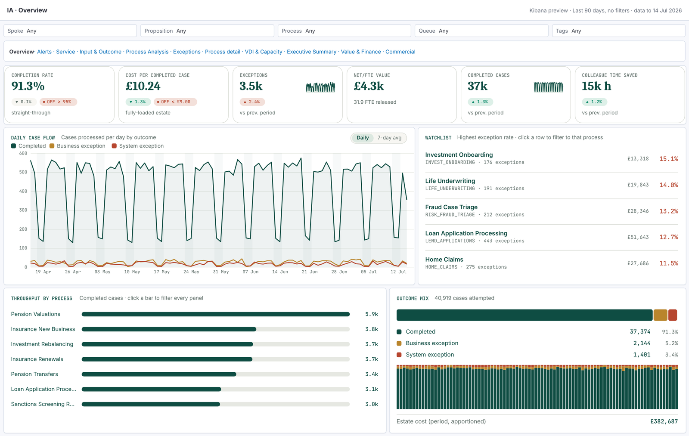

# Intelligent Automation: performance dashboards for Kibana

This is the [automation-dashboard](https://github.com/craigmitchinson/automation-dashboard) React app rebuilt as eleven Kibana dashboards made of Vega panels. It runs on the Elastic estate that already holds the Blue Prism work-queue data, so there's nothing extra to host. It keeps the React app's measures, layout and rules, and takes its colours and type from the Platform Health report (`vega/lib/tokens.mjs`). Against the same mock data, every figure checked matches it to the penny.



## What's here

| Path | What it is |
|---|---|
| `dist/kibana/ia-dashboards.ndjson` | **One import** that creates the data view, 42 panels and 10 dashboards (docs/KIBANA-SETUP.md) |
| `dist/specs/<dashboard>/<panel>.vg.json` | Each panel's Vega spec, paste-ready |
| `docs/DATA-CONTRACT.md` | **The brief for the Logstash developer**: indices, fields and every transformation |
| `docs/FORMULAS.md` | Every measure on every panel, with the React source it came from |
| `docs/SERVICE.md` | The run team's checks, the job that runs them and the alert rules |
| `docs/KIBANA-SETUP.md` | Import, settings, how the Kibana behaviour differs, alerting rules, changing a panel |
| `docs/previews/` | PNG of every dashboard and `svg/<dashboard>/<panel>.svg` for every panel, rendered from the specs against mock data |
| `etl/logstash/` | Logstash pipeline and Ruby filter for stage 1 (per-item enrichment) |
| `etl/cost-job/stamp_costs.py` | Stage 2: the scheduled daily cost job |
| `etl/service-job/` | Service checks every 15 minutes (`service_checks.py`) and the Kibana alert rules (`create_rules.py`) |
| `etl/reference-impl/` | Executable reference for both stages, plus the mock data generator |
| `etl/index-templates/` | Mappings for the five indices |
| `etl/reference/reference.json` | Team-owned reference data (same file as the React app) |
| `vega/` | Spec sources: `lib/` is the design kit (tokens, formats, cards, charts, tables, alert engine); `panels/` has one file per dashboard |
| `preview/` | Renders every spec against the mock data: a small Elasticsearch emulator runs each panel's real query |

## Dashboards

| Dashboard | Panels | Preview |
|---|---|---|
| Overview | KPIs, daily case flow, watchlist, throughput, outcome mix | [overview](docs/previews/overview.default.png) |
| Alerts | Breach and warning register, estate-wide, trailing 7 days | [estate](docs/previews/alerts.default.png) · [one spoke](docs/previews/alerts.spoke.png) |
| Service | Eight run-team checks (OK, Warning, Action), what to do now, 24-hour check history, hourly activity against usual, workers, queues, exceptions. Alerts come from the same checks. | [service](docs/previews/service.default.png) |
| Input & Outcome | KPIs, case flow, outcome split, period summary | [input-outcome](docs/previews/input-outcome.default.png) |
| Process Analysis | Performance by process (3 measures), exception trend, league table | [process-analysis](docs/previews/process-analysis.default.png) |
| Exceptions | KPIs, process × reason heatmap, searchable detail | [exceptions](docs/previews/exceptions.default.png) |
| Process detail | Chooser, or banner, KPIs, flow, top exceptions, workers and profile | [chooser](docs/previews/process-detail.default.png) · [one process](docs/previews/process-detail.process.png) |
| VDI & Capacity | KPIs, utilisation by worker, capacity table, gauge | [all](docs/previews/capacity.default.png) · [one spoke](docs/previews/capacity.spoke.png) |
| Executive Summary | FYTD KPIs, operations, estate health, by hub or proposition, movers, briefing | [estate](docs/previews/exec.default.png) · [hub](docs/previews/exec.spoke.png) |
| Value & Finance | KPIs, FY attainment, waterfall, monthly trend, spoke P&L, Pareto, review candidates | [value-finance](docs/previews/value-finance.default.png) |
| Commercial Performance | KPIs, what-if rate, cost per case and cumulative charts with 14-day forecasts | [commercial](docs/previews/commercial.default.png) |

## How it works

```
Blue Prism items in Elastic ─► Logstash (enrich) ─► ia-workqueue-items ─┐
reference.json ─────────────► cost job (daily) ─► ia-cost-daily        ├─► Vega panels in Kibana
                             └► reference loader ─► ia-vdi-daily       │   (aggregations only; ES
                                                    ia-reference ───────┘    does the arithmetic)
```

The ETL puts every per-item figure on the document: outcome, process, spoke, grade-rate benefit and stamped apportioned cost. Every panel then asks Elasticsearch for sums and receives a few hundred rows at most, which keeps them fast. The panels follow the dashboard's controls, query bar and time picker. Clicking a process filters the whole dashboard.

## Commands

```bash
npm install
npm run mock      # mock CSV -> the four indices as _bulk NDJSON in mock/ (≈10 s)
npm run build     # panels -> dist/specs + dist/kibana/ia-dashboards.ndjson
npm test          # every spec parses; ETL reproduces the React totals
npm run test:etl  # Ruby filter and Python cost job agree with the reference implementation
npm run mock:service  # run the service check job against the mock for 24 hours (≈2 min)
npm run preview   # run every query against mock/, render docs/previews/*.png
```

The preview needs Python with Playwright and Pillow. The ETL test needs Ruby.

## Status and limits

- **Proven:** the numbers (ETL reference = React app to the penny; Ruby and Python twins match it), that every spec renders, and the queries (run through an emulator of the Elasticsearch subset they use, under Kibana's context substitution rules).
- **Service checks:** the dashboard and the alerting job agree on every check at seven moments in the mock data (tests/service.test.mjs), and the job has run end to end against an emulated cluster.
- **Not yet run in a real Kibana:** the import file, the `%context%` and `%timefilter%` handling, `kibanaAddFilter`, the controls and the alert rules API. Expect one round of fixes on first load. docs/KIBANA-SETUP.md section 7 lists the likely ones.
- **Behaviour that doesn't carry over from the React app:** acknowledge and snooze (use alerting rules), saved views, admin editing, the accessibility panel, scrolling inside a panel, and a what-if slider that changes every page. docs/KIBANA-SETUP.md section 4 has the full mapping.
